<h1 align="center">Hey, I'm Aurelio Almeida! </h1>

  

  
  

  

 

<h3 align="center">🛡️ Security</h3>

  
  
  
  
  
  
  
  
  
  
  

<h3 align="center">🖧 Infrastructure</h3>

  

<h3 align="center">💻 Development</h3>

  

 

  

 

<picture>
  <source media="(prefers-color-scheme: dark)" srcset="https://raw.githubusercontent.com/AurelioAlmeidaB/AurelioAlmeidaB/output/totodile-contribution-grid-dark.svg">
  <source media="(prefers-color-scheme: light)" srcset="https://raw.githubusercontent.com/AurelioAlmeidaB/AurelioAlmeidaB/output/totodile-contribution-grid.svg">
  
</picture>
